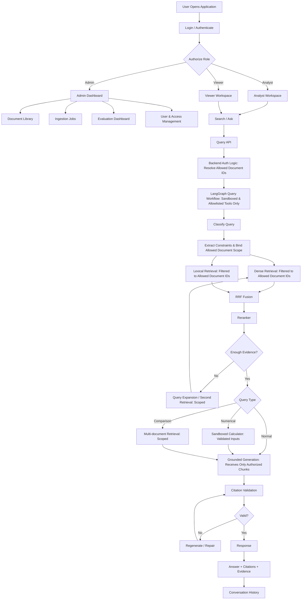
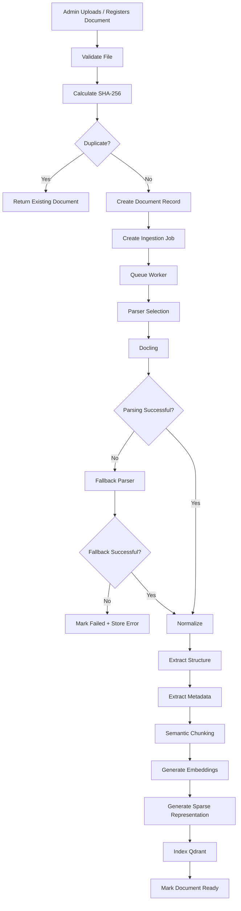
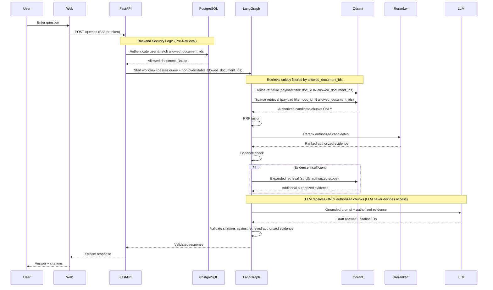
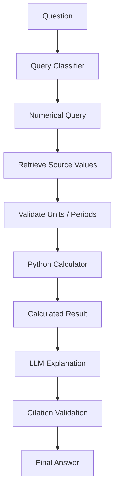
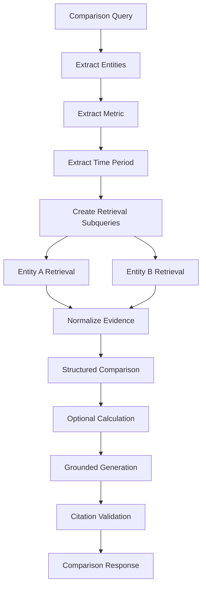
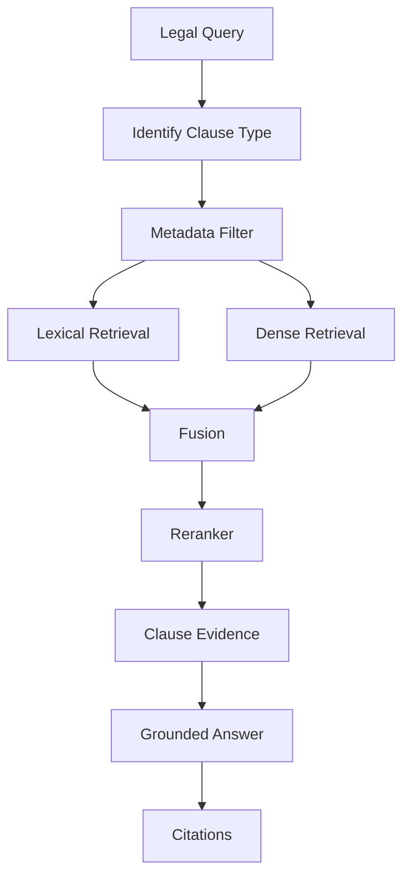
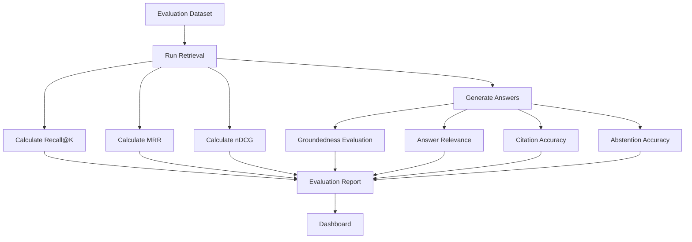
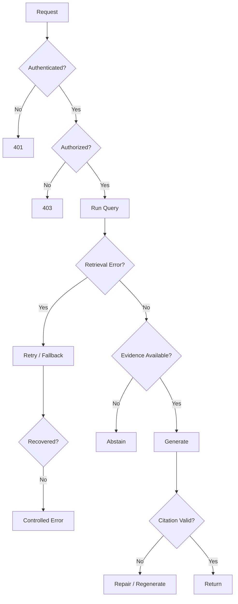

# APP FLOW DIAGRAM — Real-World Document Intelligence & Agentic RAG Platform

## 1. High-Level Application Flow



---

# 2. Document Ingestion Flow



---

# 3. Search Flow



---

# 4. Numerical Question Flow



The model should not be the authoritative calculator.

---

# 5. Comparison Flow



---

# 6. Legal Contract Flow



---

# 7. Admin Ingestion UI Flow

```text
Admin Dashboard
      ↓
Documents
      ↓
Add Document
      ↓
Select source type
      ↓
Upload / register source
      ↓
Validate metadata
      ↓
Start ingestion
      ↓
Job status
      ↓
Parsing
      ↓
Chunking
      ↓
Embedding
      ↓
Indexing
      ↓
Ready
```

---

# 8. Evaluation Flow



---

# 9. Failure Flow



---

# 10. UX Principle

The primary screen should make the system's reasoning traceable:

```text
Question
   ↓
Answer
   ↓
Sources
   ↓
Evidence
   ↓
Document
   ↓
Page / Section
```

Do not expose hidden chain-of-thought. Expose concise, auditable retrieval information only:

- query type
- filters
- number of retrieved candidates
- selected sources
- citations
- latency

---

# 11. Main Screens

```text
/login
/dashboard
/search
/chat
/documents
/documents/[id]
/documents/[id]/preview
/evaluations
/evaluations/[id]
/admin/users
/admin/jobs
/settings
```

---

# 12. Security Enforcement & Tool Sandboxing Flow

## 12.1 Pre-Retrieval Authorization vs. Data Leak Anti-Pattern

### ❌ Dangerous Anti-Pattern (LLM-Decided Access / Unfiltered Retrieval)
```text
User A
  ↓
Question
  ↓
Retriever (No Pre-Filtering)
  ↓
❌ Retrieves a document User A isn't authorized to see
  ↓
LLM (Prompted: "Only show if user has access")
  ↓
⚠️ DATA LEAK: Chunks already exposed in prompt context / token stream
```

### ✅ Enforced Architecture (Pre-Retrieval Backend Security Logic)
```text
User
  ↓
Authentication (JWT)
  ↓
Authorization (PostgreSQL roles & document_access)
  ↓
Allowed document IDs / metadata scope
  ↓
Retriever (Qdrant filter: document_id IN allowed_document_ids)
  ↓
Only authorized chunks retrieved
  ↓
Reranker
  ↓
LLM (Receives ONLY authorized evidence)
  ↓
Citation validation
  ↓
Answer
```

> **Rule:** The LLM should never be responsible for deciding whether a user is allowed to see a document. That is backend security logic.

## 12.2 Agent Tool Sandboxing

LangGraph agents are strictly prohibited from possessing unrestricted tools:

| Prohibited Tools | Reason |
|---|---|
| `execute_shell()` | Potential arbitrary code execution on host |
| `run_sql()` | Potential SQL injection and direct bypass of access controls |
| `arbitrary_http_request()` | SSRF and unauthenticated egress risks |
| `read_any_file()` | Arbitrary filesystem access / credential leakage |

### Allowed Tools (Strictly Validated Inputs)
- `retrieve_authorized_evidence`: Constrained to the user's `allowed_document_ids`.
- `calculator`: Sandboxed mathematical evaluations with typed numbers and allowed operators.
- `document_metadata`: Bounded read-only lookup of accessible document properties.
