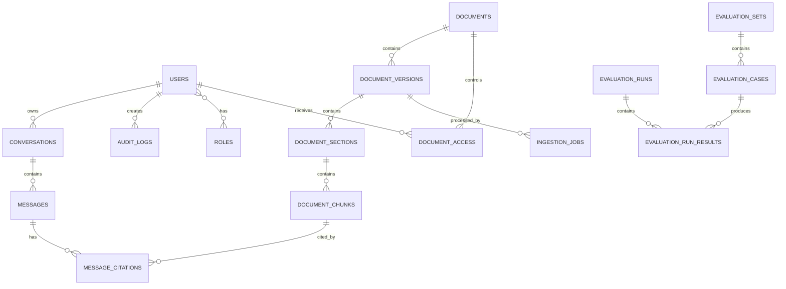

# DATABASE SCHEMA — PostgreSQL

## 1. Database Responsibilities

PostgreSQL is the authoritative relational store.

Use it for:

- authentication
- authorization
- document metadata
- parser metadata
- chunk metadata
- ingestion jobs
- queries
- conversations
- citations
- evaluations
- audit logs

Do not store large vector arrays in PostgreSQL when Qdrant is being used.

---

# 2. ER Diagram



---

# 3. users

```sql
users
-----
id UUID PK
email VARCHAR UNIQUE NOT NULL
password_hash TEXT NOT NULL
full_name VARCHAR
is_active BOOLEAN DEFAULT TRUE
created_at TIMESTAMP
updated_at TIMESTAMP
last_login_at TIMESTAMP NULL
```

---

# 4. roles

```sql
roles
-----
id UUID PK
name VARCHAR UNIQUE
description TEXT
```

Seed:

```text
ADMIN
ANALYST
VIEWER
```

---

# 5. user_roles

```sql
user_roles
----------
user_id UUID FK users.id
role_id UUID FK roles.id

PRIMARY KEY (user_id, role_id)
```

---

# 6. documents

Logical document identity.

```sql
documents
---------
id UUID PK
title TEXT NOT NULL
source_type VARCHAR NOT NULL
document_type VARCHAR NOT NULL
organization VARCHAR NULL
ticker VARCHAR NULL
report_year INTEGER NULL
source_uri TEXT NULL
content_hash VARCHAR(64) UNIQUE NOT NULL
language VARCHAR(20)
status VARCHAR NOT NULL
created_at TIMESTAMP
updated_at TIMESTAMP
```

Examples:

```text
source_type:
sec
cuad
manual
doclaynet

document_type:
annual_report
legal_contract
layout_benchmark
```

---

# 7. document_versions

```sql
document_versions
-----------------
id UUID PK
document_id UUID FK documents.id
version_label VARCHAR
source_file_path TEXT
file_name TEXT
mime_type VARCHAR
file_size BIGINT
parser_name VARCHAR
parser_version VARCHAR
parse_status VARCHAR
page_count INTEGER NULL
checksum VARCHAR(64)
created_at TIMESTAMP
```

A document can have multiple versions without overwriting historical processing.

---

# 8. document_sections

```sql
document_sections
-----------------
id UUID PK
document_version_id UUID FK document_versions.id
parent_section_id UUID NULL FK document_sections.id
heading TEXT
heading_level INTEGER
section_order INTEGER
page_start INTEGER NULL
page_end INTEGER NULL
path TEXT
metadata JSONB
created_at TIMESTAMP
```

Example:

```text
Part I
Part I > Item 1
Part I > Item 1 > Business
Part II > Item 8 > Financial Statements
```

---

# 9. document_chunks

```sql
document_chunks
---------------
id UUID PK
document_version_id UUID FK document_versions.id
section_id UUID NULL FK document_sections.id
chunk_index INTEGER
chunk_type VARCHAR
text TEXT NOT NULL
token_count INTEGER
page_start INTEGER NULL
page_end INTEGER NULL
heading_path TEXT NULL
table_html TEXT NULL
metadata JSONB
content_hash VARCHAR(64)
created_at TIMESTAMP
```

Unique constraint:

```text
(document_version_id, chunk_index)
```

---

# 10. document_access

```sql
document_access
---------------
id UUID PK
document_id UUID FK documents.id
user_id UUID FK users.id NULL
role_id UUID FK roles.id NULL
permission VARCHAR NOT NULL
created_at TIMESTAMP
```

Permission examples:

```text
read
manage
admin
```

Application logic must reject ambiguous access rules.

**Pre-Retrieval Enforcement:**
This table is queried by backend authorization logic to resolve the exact list of `allowed_document_ids` for the user. That list is injected into retriever queries (Qdrant filters) so unauthorized documents are never retrieved. The LLM is never responsible for access control.

---

# 11. ingestion_jobs

```sql
ingestion_jobs
--------------
id UUID PK
document_id UUID FK documents.id
document_version_id UUID FK document_versions.id
job_type VARCHAR
status VARCHAR
progress INTEGER
current_stage VARCHAR
retry_count INTEGER DEFAULT 0
error_message TEXT NULL
started_at TIMESTAMP NULL
finished_at TIMESTAMP NULL
created_at TIMESTAMP
```

Statuses:

```text
queued
running
completed
failed
cancelled
```

---

# 12. conversations

```sql
conversations
-------------
id UUID PK
user_id UUID FK users.id
title VARCHAR
created_at TIMESTAMP
updated_at TIMESTAMP
```

---

# 13. messages

```sql
messages
--------
id UUID PK
conversation_id UUID FK conversations.id
role VARCHAR
content TEXT
query_type VARCHAR NULL
grounded BOOLEAN NULL
abstained BOOLEAN DEFAULT FALSE
latency_ms INTEGER NULL
token_usage JSONB NULL
created_at TIMESTAMP
```

Roles:

```text
user
assistant
system
```

---

# 14. message_citations

```sql
message_citations
-----------------
id UUID PK
message_id UUID FK messages.id
chunk_id UUID FK document_chunks.id
citation_label VARCHAR
page_start INTEGER NULL
page_end INTEGER NULL
evidence_text TEXT
validation_status VARCHAR
created_at TIMESTAMP
```

---

# 15. queries

Stores retrieval diagnostics.

```sql
queries
-------
id UUID PK
user_id UUID FK users.id
message_id UUID FK messages.id
raw_query TEXT
normalized_query TEXT
query_type VARCHAR
filters JSONB
retrieval_config JSONB
created_at TIMESTAMP
```

---

# 16. retrieval_runs

```sql
retrieval_runs
--------------
id UUID PK
query_id UUID FK queries.id
dense_results JSONB
sparse_results JSONB
fusion_results JSONB
reranked_results JSONB
latency_ms INTEGER
created_at TIMESTAMP
```

For long-term scale, large retrieval traces can later be moved to object storage or an observability system.

---

# 17. evaluation_sets

```sql
evaluation_sets
---------------
id UUID PK
name VARCHAR
description TEXT
version VARCHAR
created_at TIMESTAMP
```

---

# 18. evaluation_cases

```sql
evaluation_cases
----------------
id UUID PK
evaluation_set_id UUID FK evaluation_sets.id
question TEXT
expected_answer TEXT NULL
query_type VARCHAR
metadata JSONB
created_at TIMESTAMP
```

---

# 19. evaluation_references

```sql
evaluation_references
---------------------
id UUID PK
evaluation_case_id UUID FK evaluation_cases.id
chunk_id UUID FK document_chunks.id
relevance_grade INTEGER
created_at TIMESTAMP
```

Grades:

```text
0 = irrelevant
1 = partially relevant
2 = highly relevant
```

---

# 20. evaluation_runs

```sql
evaluation_runs
---------------
id UUID PK
evaluation_set_id UUID FK evaluation_sets.id
configuration JSONB
status VARCHAR
started_at TIMESTAMP
finished_at TIMESTAMP NULL
created_at TIMESTAMP
```

---

# 21. evaluation_run_results

```sql
evaluation_run_results
----------------------
id UUID PK
evaluation_run_id UUID FK evaluation_runs.id
evaluation_case_id UUID FK evaluation_cases.id
retrieved_chunk_ids JSONB
answer TEXT
recall_at_k JSONB
mrr FLOAT NULL
ndcg_at_k JSONB
answer_relevance FLOAT NULL
groundedness FLOAT NULL
citation_accuracy FLOAT NULL
abstention_correct BOOLEAN NULL
latency_ms INTEGER
created_at TIMESTAMP
```

---

# 22. audit_logs

```sql
audit_logs
----------
id UUID PK
user_id UUID FK users.id NULL
action VARCHAR
resource_type VARCHAR
resource_id UUID NULL
ip_hash VARCHAR NULL
metadata JSONB
created_at TIMESTAMP
```

Do not store raw sensitive credentials or access tokens.

---

# 23. Recommended Indexes

```sql
CREATE INDEX idx_documents_org_year
ON documents(organization, report_year);

CREATE INDEX idx_documents_type
ON documents(document_type);

CREATE INDEX idx_chunks_document
ON document_chunks(document_version_id);

CREATE INDEX idx_chunks_section
ON document_chunks(section_id);

CREATE INDEX idx_jobs_status
ON ingestion_jobs(status);

CREATE INDEX idx_messages_conversation
ON messages(conversation_id);

CREATE INDEX idx_queries_user
ON queries(user_id);

CREATE INDEX idx_audit_created
ON audit_logs(created_at);
```

For JSONB fields that are frequently filtered, add targeted GIN indexes rather than indexing every JSONB column blindly. PostgreSQL supports GIN indexes for JSONB and full-text search. citeturn1search0turn1search11

---

# 24. Migration Rules

Use Alembic.

Rules:

1. Never manually modify production schema.
2. Every schema change gets a migration.
3. Migrations must be reversible where practical.
4. Seed roles through migration.
5. Test migrations from an empty database.

---

# 25. Qdrant ↔ PostgreSQL Relationship

PostgreSQL:

```text
chunk_id
document_id
metadata
text
```

Qdrant:

```text
point_id = chunk_id
dense vector
sparse vector
payload
```

The UUID `chunk_id` is the cross-system identity.

Never use vector database point order as an identifier.
