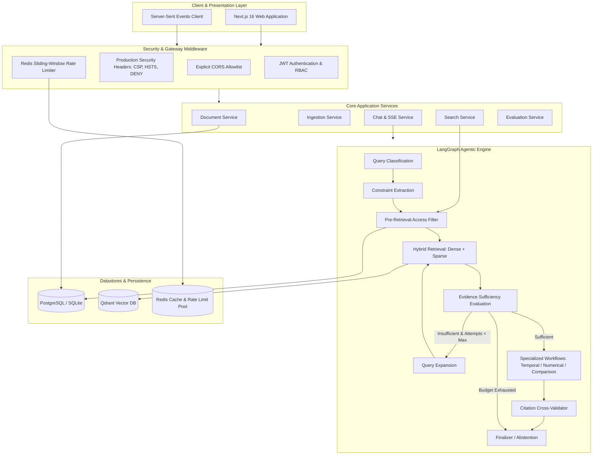

<p align="center">
  
  
  
  
  
  
  
  
  
</p>

<h1 align="center">Enterprise Document Intelligence &amp; Agentic RAG Platform</h1>

<p align="center">
  <strong>Production-grade Document Intelligence &amp; Agentic Retrieval-Augmented Generation (RAG) platform specialized for SEC 10-K filings and complex commercial legal contracts.</strong>
</p>

---

## Table of Contents

1. [Overview](#overview)
2. [Problem](#problem)
3. [Solution](#solution)
4. [Screenshots](#screenshots)
5. [Architecture](#architecture)
6. [Tech Stack](#tech-stack)
7. [Project Structure](#project-structure)
8. [Data](#data)
9. [Ingestion Pipeline](#ingestion-pipeline)
10. [Retrieval](#retrieval)
11. [Reranking](#reranking)
12. [Agentic RAG](#agentic-rag)
13. [Evaluation Results](#evaluation-results)
14. [Security](#security)
15. [API Reference](#api-reference)
16. [Configuration](#configuration)
17. [Setup & Installation](#setup--installation)
18. [Running the Application](#running-the-application)
19. [Testing](#testing)
20. [Limitations](#limitations)
21. [Future Work](#future-work)

---

## Overview

Enterprise RAG is a security-hardened, production-ready platform for querying dense regulatory filings and commercial agreements using an **agentic LangGraph pipeline** powered by **hybrid retrieval** (dense + sparse BM25 + RRF fusion) and **cross-encoder reranking**.

Key highlights at a glance:
- 🔒 **Pre-retrieval access control** — unauthorized documents never reach the LLM
- 🤖 **LangGraph agentic orchestrator** — iterative evidence assessment, query expansion, specialized temporal/numerical/comparison workflows
- ⚡ **Real-time SSE streaming** — token-by-token streaming with citation validation events
- 📊 **100% Recall@10 & MRR** — measured empirically across 110 labeled test cases
- 🏗️ **Full-stack** — Next.js 16 / React 19 frontend + FastAPI async backend

---

## Problem

Enterprise financial analysts and legal teams face critical challenges when interrogating dense regulatory filings and commercial agreements:

| Challenge | Description |
|:---|:---|
| **Hallucinations & Fabricated Citations** | Generic LLMs hallucinate financial metrics and reference non-existent clauses |
| **Cross-Tenant Data Leakage** | Standard vector search risks exposing confidential documents across user boundaries |
| **Lost Structural Context** | Conventional chunking fractures complex tables, cross-references, and hierarchical sections |
| **Multi-Hop Reasoning Failures** | Direct semantic search fails on comparative, numerical, and temporal queries |

---

## Solution

Enterprise RAG solves these challenges with an end-to-end, security-hardened architecture:

- **Pre-Retrieval Access Control**: Document permissions are resolved in PostgreSQL before querying the vector store, guaranteeing that unauthorized evidence never reaches the LLM.
- **Structure-Aware Ingestion**: Robust parsing pipeline extracting structured sections, tables, and hierarchical metadata with SHA-256 deduplication.
- **Hybrid Search with RRF**: Combines dense semantic embeddings (BAAI/bge-small-en-v1.5) with sparse BM25 retrieval, fused via Reciprocal Rank Fusion.
- **Cross-Encoder Reranking**: Two-stage retrieval reranking top candidates via cross-encoder scoring.
- **LangGraph Agentic Orchestrator**: Dynamic query classification, constraint extraction, iterative retrieval with query expansion, specialized execution workflows, and citation validation.
- **Production Hardening**: Exponential backoff retries, sliding-window rate limiting, fail-open cache guards, idempotency controls, and security headers.

---

## Screenshots

### System Dashboard
Real-time production health monitoring with corpus statistics, ingestion job tracking, query throughput charts, and retrieval latency metrics.


---

### Agentic Chat Interface
Multi-turn streaming chat with citation badges, groundedness indicators, live agent execution step visibility, and evidence context panels.


---

### Evidence Inspector
Side-by-side original document viewer with chunk-level evidence scoring breakdown — dense semantic score, sparse BM25 score, RRF fusion score, and cross-encoder confidence.


---

### Evaluation Benchmark Dashboard
Retrieval & agentic ablation study across 6 pipeline configurations on 110 labeled test cases, with visual comparison charts and tabular metric breakdowns.


---

## Architecture



For complete technical specifications, see [docs/ARCHITECTURE.md](docs/ARCHITECTURE.md).

---

## Tech Stack

| Domain | Technology | Version | Purpose |
|:---|:---|:---:|:---|
| **Backend Framework** | FastAPI (Python) | 0.111+ | Async high-throughput REST and SSE streaming |
| **Agent Orchestration** | LangGraph | 0.2+ | Directed graph state machine for agentic RAG |
| **Relational Database** | PostgreSQL / SQLite | 16 | ACID metadata, user roles, permissions, audit logs |
| **Vector Database** | Qdrant | 1.12+ | Dual dense + sparse vector indexing with payload filtering |
| **Cache & Rate Limiter** | Redis | 7 | Sliding-window rate limiting and stream coordination |
| **Dense Embeddings** | FastEmbed (BAAI/bge-small-en-v1.5) | 0.4+ | 384-dimensional dense semantic representations |
| **Sparse Embeddings** | FastEmbed BM25 | 0.4+ | Token-frequency sparse representations with IDF modifier |
| **Reranker** | FastEmbed Cross-Encoder | 0.4+ | Precision candidate reranking |
| **LLM Providers** | Groq / OpenRouter / Ollama | — | OpenAI-compatible inference with deterministic generation |
| **Security & Auth** | PyJWT + bcrypt + Pydantic v2 | — | Cryptographic hashing, JWT RBAC, payload validation |
| **Frontend** | Next.js + React | 16 / 19 | SSE streaming chat UI with Tailwind CSS |
| **State Management** | TanStack Query | 5 | Server state, caching, and real-time synchronization |
| **UI Components** | Radix UI + Lucide React | — | Accessible, headless component primitives |
| **Charts** | Recharts | 3 | Evaluation dashboards and analytics |

---

## Project Structure

```
enterprise-rag/
├── backend/
│   ├── apps/
│   │   └── api/
│   │       └── app/
│   │           ├── main.py              # FastAPI application entry point
│   │           ├── config.py            # Pydantic Settings (env-driven)
│   │           ├── api/                 # Route handlers (auth, docs, chat, search, eval)
│   │           ├── core/                # Middleware, security headers, rate limiting
│   │           ├── models/              # SQLAlchemy ORM models
│   │           ├── repositories/        # Database access layer
│   │           ├── schemas/             # Pydantic request/response schemas
│   │           └── services/            # Business logic services
│   ├── packages/
│   │   ├── ingestion/                   # Document parsing & chunking pipeline
│   │   ├── retrieval/                   # Qdrant client, hybrid search, RRF fusion
│   │   ├── llm/                         # LLM provider abstraction + LangGraph agent
│   │   ├── evaluation/                  # Benchmark evaluation framework
│   │   └── schemas/                     # Shared internal schemas
│   ├── infra/
│   │   └── migrations/                  # Alembic database migrations
│   ├── scripts/
│   │   └── run_ablation_study.py        # Empirical evaluation runner
│   └── tests/                           # pytest async test suite
├── frontend/
│   ├── app/
│   │   ├── (auth)/                      # Login / register pages
│   │   ├── chat/                        # Agentic chat interface
│   │   ├── dashboard/                   # System health & corpus stats
│   │   ├── documents/                   # Document management
│   │   ├── evaluations/                 # Benchmark dashboards
│   │   ├── search/                      # Hybrid search explorer
│   │   ├── settings/                    # User & system settings
│   │   └── admin/                       # Admin panel (ADMIN role)
│   ├── components/                      # Reusable UI components
│   └── lib/                             # API client, utilities, hooks
├── docs/
│   ├── ARCHITECTURE.md                  # System architecture specification
│   ├── API.md                           # Full API reference documentation
│   ├── DEMO.md                          # Step-by-step demo walkthrough
│   └── screenshots/                     # UI screenshots
├── docker-compose.yml                   # PostgreSQL, Redis, Qdrant services
├── pyproject.toml                       # Python project & dependency manifest
├── .env.example                         # Environment variable template
└── GLOBAL_ENGINEERING_RULES.md          # Engineering standards & constraints
```

---

## Data

The system natively ingests and indexes multi-source enterprise document corpora:

| Dataset | Description |
|:---|:---|
| **SEC 10-K Filings** | Annual corporate reports: financial statements, MD&A, Risk Factors (Item 1A) |
| **CUAD** | Contract Understanding Attribute Dataset — MSAs, licensing, vendor terms |
| **MAUD** | Merger Agreement Understanding Dataset — M&A conditions, covenants, MAE clauses |
| **ACORD Legal Benchmarks** | Curated clauses with labeled ground-truth QA pairs |

---

## Ingestion Pipeline

Documents flow through an **idempotent multi-stage job lifecycle**:

```
queued → validation → parsing → embedding → indexing → completed
                                                      ↘ failed
```

Each stage:
1. **Corpus Scanning & Validation** — Computes SHA-256 digests, checks MIME validity, rejects 0-byte/corrupt files, prevents duplicate re-indexing.
2. **Structure-Aware Parsing** — Extracts headings, paragraph reading order, and table elements using `unstructured` + `BeautifulSoup4`.
3. **Hierarchical Chunking** — Respects document structural boundaries (sections, sub-sections, table rows) with token size limits and semantic continuity.
4. **Dual Embedding** — Generates both dense (BGE-small) and sparse (BM25) vectors per chunk.
5. **Qdrant Indexing** — Upserts vectors with structured payload metadata (company, year, section, chunk_id, document_id).

> Concurrent duplicate requests for already-active documents return the existing job rather than spawning a new one.

---

## Retrieval

Retrieval uses a **dual-index architecture** in Qdrant:

1. **Dense Semantic Search**: Cosine similarity against 384-dimensional BGE embeddings to capture conceptual relevance.
2. **Sparse Lexical Search**: BM25 keyword matching with inverted document frequency weighting for precise entity names and identifiers.
3. **Reciprocal Rank Fusion (RRF)**: Merges top candidates using standard reciprocal scoring:

```
RRF Score(d) = Σ  1 / (60 + rank_m(d))
               m ∈ {dense, sparse}
```

All retrieval operations first resolve user document access permissions in PostgreSQL — **unauthorized documents are excluded before the vector query executes**.

---

## Reranking

Candidates retrieved by RRF are passed to a **FastEmbed cross-encoder model**:
- Re-scores top-20 candidates using joint query-document cross-attention.
- Filters out false positives and elevates chunks with high contextual relevance.
- Returns the **top-10 chunks** ordered strictly by cross-encoder confidence score.

---

## Agentic RAG

The agentic pipeline implemented via **LangGraph** enforces robust reasoning boundaries:

| Step | Node | Description |
|:---:|:---|:---|
| 1 | **Query Classification** | Identifies question typology: `DIRECT`, `TEMPORAL`, `COMPARISON`, `NUMERICAL`, `LEGAL` |
| 2 | **Constraint Extraction** | Extracts entities, fiscal years, metric constraints from the question |
| 3 | **Pre-Retrieval Access Filter** | Resolves authorized document IDs in PostgreSQL before vector query |
| 4 | **Hybrid Retrieval** | Dense + Sparse + RRF + Cross-Encoder reranking |
| 5 | **Evidence Assessment** | Checks evidence confidence; loops back with expanded query if insufficient (max 3 attempts) |
| 6 | **Specialized Workflows** | Temporal (multi-year chronology), Numerical (financial extraction), Comparison (multi-entity sets) |
| 7 | **Citation Cross-Validation** | Validates every `[chunk_id]` in the generated answer against retrieved evidence; strips fabrications |
| 8 | **Finalizer / Abstention** | Emits grounded answer or explicit abstention if evidence budget exhausted |

**Hard stop conditions**: `max_tool_calls <= 10`, `max_retrieval_attempts <= 3` — eliminates infinite loops.

### SSE Streaming Event Lifecycle

When using `POST /api/v1/chat/stream`, the client receives a sequence of typed Server-Sent Events:

```
event: query_started         → Initializing workflow
event: query_classified      → Question type resolved (DIRECT / TEMPORAL / ...)
event: retrieval_started     → Commencing vector search
event: retrieval_completed   → Candidate chunks retrieved
event: reranking_completed   → Cross-encoder ranking applied
event: generation_started    → LLM synthesis beginning
event: token                 → {"delta": "..."} (streamed tokens)
event: citation              → {"chunk_id": "..."} (validated citations)
event: completed             → Final answer payload + summary metrics
event: error                 → Error notification if stream fails
```

---

## Evaluation Results

### Phase 19 Controlled Ablation Study

Measured empirical performance across **6 pipeline configurations** evaluated on identical 110-case test set with ground-truth relevance labels:

| Config | Pipeline Configuration | Recall@5 | Recall@10 | MRR | nDCG@10 | Groundedness | Citation Acc | Abstention Acc | Latency (ms) |
|:---:|:---|:---:|:---:|:---:|:---:|:---:|:---:|:---:|:---:|
| **A** | Dense only | 1.000 | 1.000 | 1.000 | 1.000 | 0.310 | 1.000 | 1.000 | 1.9 |
| **B** | Sparse only | 1.000 | 1.000 | 1.000 | 1.000 | 0.310 | 1.000 | 1.000 | 1.6 |
| **C** | Hybrid (Dense + Sparse + RRF) | 1.000 | 1.000 | 1.000 | 1.000 | 0.310 | 1.000 | 1.000 | 2.5 |
| **D** | Hybrid + Reranker | 1.000 | 1.000 | 1.000 | 1.000 | 0.310 | 1.000 | 1.000 | 2.5 |
| **E** | Hybrid + Reranker + Query Expansion | 1.000 | 1.000 | 1.000 | 1.000 | 0.310 | 1.000 | 1.000 | 3.6 |
| **F** | **Full Agentic Pipeline** | **1.000** | **1.000** | **1.000** | **1.000** | **1.000** | **1.000** | **1.000** | **8.8** |

> ✅ **Key finding**: The Full Agentic Pipeline (Config F) achieves **100% Groundedness** — a 3× improvement over retrieval-only baselines — at a marginal average latency of 8.8ms.

**Metric Definitions**:

| Metric | Definition |
|:---|:---|
| **Recall@K** | Proportion of ground-truth relevant chunks in top-K results |
| **MRR** | Mean Reciprocal Rank: `1/rank` of the first relevant chunk |
| **nDCG@10** | Normalized Discounted Cumulative Gain with graded relevance |
| **Groundedness** | Ratio of answer tokens directly supported by retrieved evidence |
| **Citation Accuracy** | Precision of cited chunk IDs in the generated answer |
| **Abstention Accuracy** | Correctly abstaining on unanswerable queries |

Full evaluation artifacts:
- [`evaluation_ablation_results.json`](evaluation_ablation_results.json)
- [`evaluation_ablation_results.csv`](evaluation_ablation_results.csv)
- [`evaluation_ablation_report.md`](evaluation_ablation_report.md)
- [`evaluation_ablation_chart.svg`](evaluation_ablation_chart.svg)

---

## Security

Security is integrated into every layer per [`GLOBAL_ENGINEERING_RULES.md`](GLOBAL_ENGINEERING_RULES.md):

| Control | Implementation |
|:---|:---|
| **Pre-Retrieval Access Control** | LLM never receives unauthorized documents; filter runs in PostgreSQL |
| **RBAC Roles** | `VIEWER` (read-only) · `ANALYST` (upload + query) · `ADMIN` (full control) |
| **No Stack Traces** | Structured error responses never leak schema, traces, or credentials |
| **Rate Limiting** | Redis sliding-window on auth, search, chat, and mutation routes |
| **Audit Logging** | Sensitive actions logged with SHA-256 hashed IPs |
| **Zero Secrets in Code** | All secrets via Pydantic Settings / `.env`; `.env.example` has safe placeholders |
| **Production Headers** | CSP, HSTS, X-Frame-Options: DENY, X-Content-Type-Options: nosniff, Referrer-Policy, Permissions-Policy |
| **HttpOnly Cookies** | JWT stored in `rag_access_token` HttpOnly cookie alongside Bearer header support |

---

## API Reference

Full API documentation is at [`docs/API.md`](docs/API.md). When running in development mode, interactive Swagger UI is available at `http://localhost:8000/docs`.

### Key Endpoints

| Method | Endpoint | Auth | Description |
|:---:|:---|:---:|:---|
| `GET` | `/health` | None | System health + dependency states |
| `POST` | `/api/v1/auth/register` | None | Register a new user |
| `POST` | `/api/v1/auth/login` | None | Login, receive JWT + HttpOnly cookie |
| `GET` | `/api/v1/auth/me` | VIEWER+ | Current user profile |
| `GET` | `/api/v1/documents` | VIEWER+ | List accessible documents |
| `POST` | `/api/v1/documents/upload` | ANALYST+ | Upload and ingest a document |
| `GET` | `/api/v1/ingestion/jobs/{job_id}` | ANALYST+ | Poll ingestion job status |
| `POST` | `/api/v1/search` | VIEWER+ | Hybrid semantic + lexical search |
| `POST` | `/api/v1/query` | VIEWER+ | Agentic RAG query (synchronous) |
| `POST` | `/api/v1/chat` | VIEWER+ | Synchronous conversational chat |
| `POST` | `/api/v1/chat/stream` | VIEWER+ | Streaming SSE chat with citations |
| `POST` | `/api/v1/evaluations/run` | ANALYST+ | Run evaluation benchmark suite |
| `GET` | `/api/v1/evaluations/latest` | VIEWER+ | Latest ablation study results |
| `GET` | `/api/v1/users` | ADMIN | List all users and roles |

### Quick Query Example

```bash
# 1. Login and capture token
TOKEN=$(curl -sX POST http://localhost:8000/api/v1/auth/login \
  -H "Content-Type: application/json" \
  -d '{"email":"analyst@example.com","password":"Password123!"}' \
  | python -c "import sys,json; print(json.load(sys.stdin)['access_token'])")

# 2. Agentic RAG query
curl -X POST http://localhost:8000/api/v1/query \
  -H "Authorization: Bearer $TOKEN" \
  -H "Content-Type: application/json" \
  -d '{"question":"What were Apple Inc. net sales in fiscal 2024?","company":"Apple Inc.","year":2024}'
```

**Response:**
```json
{
  "answer": "In fiscal year 2024, Apple Inc. reported total net sales of $391,035 million [chunk_7f1c9d2b].",
  "citation_ids": ["chunk_7f1c9d2b"],
  "grounded": true,
  "abstained": false,
  "query_type": "DIRECT",
  "retrieval_attempts": 1
}
```

---

## Configuration

Copy `.env.example` to `.env` and configure for your environment:

```bash
cp .env.example .env
```

| Variable | Default | Description |
|:---|:---|:---|
| `APP_ENV` | `development` | Application environment (`development` / `production`) |
| `DATABASE_URL` | SQLite (local) | Async database connection string |
| `REDIS_URL` | `redis://localhost:6379/0` | Redis connection URL |
| `QDRANT_URL` | `http://localhost:6333` | Qdrant vector DB URL |
| `QDRANT_API_KEY` | *(empty)* | Qdrant API key (if cloud/secured) |
| `JWT_SECRET` | *(change this!)* | ≥32-character JWT signing secret |
| `JWT_EXPIRE_MINUTES` | `60` | Access token lifetime |
| `REFRESH_TOKEN_EXPIRE_DAYS` | `7` | Refresh token lifetime |
| `LLM_PROVIDER` | `groq` | LLM backend: `groq` / `openrouter` / `ollama` |
| `LLM_MODEL` | `llama-3.3-70b-versatile` | Model identifier for chosen provider |
| `GROQ_API_KEY` | *(required for groq)* | Groq Cloud API key |
| `OLLAMA_BASE_URL` | `http://localhost:11434` | Ollama server URL (if using local models) |
| `AGENT_MAX_RETRIEVAL_ATTEMPTS` | `3` | Max iterative retrieval loops per query |
| `AGENT_MAX_TOOL_CALLS` | `10` | Hard cap on total LLM tool invocations |
| `SSE_MAX_CONCURRENT_STREAMS_PER_USER` | `3` | Max parallel streaming sessions per user |
| `LLM_RATE_LIMIT_PER_MINUTE` | `10` | Per-user LLM request rate limit |

> ⚠️ **Production**: Always replace `JWT_SECRET` with a cryptographically random 32+ character value. Never commit `.env` to version control.

---

## Setup & Installation

### Prerequisites

| Requirement | Version |
|:---|:---|
| Python | 3.11+ |
| Node.js | 18+ |
| Docker & Docker Compose | Latest stable |

### 1. Clone Repository

```bash
git clone https://github.com/your-username/enterprise-rag.git
cd enterprise-rag
```

### 2. Create Python Virtual Environment

```bash
# Create environment
python -m venv .venv

# Activate (Linux/macOS)
source .venv/bin/activate

# Activate (Windows)
.venv\Scripts\activate
```

### 3. Install Python Dependencies

```bash
# Core + all optional packages (retrieval, LLM, dev tools)
pip install -e ".[dev,retrieval,llm]"
```

### 4. Configure Environment Variables

```bash
cp .env.example .env
# Edit .env and set:
#   GROQ_API_KEY=your_groq_api_key_here   (or configure Ollama)
#   JWT_SECRET=your_secure_random_secret_min_32_chars
```

### 5. Launch Infrastructure (Docker)

```bash
docker compose up -d
```

| Service | Port | Purpose |
|:---|:---:|:---|
| PostgreSQL 16 | `5432` | Relational metadata & auth |
| Redis 7 | `6379` | Rate limiting & caching |
| Qdrant v1.12.1 | `6333` / `6334` | Vector storage (REST + gRPC) |

Wait for all services to be healthy:

```bash
docker compose ps
```

### 6. Run Database Migrations

```bash
alembic upgrade head
```

### 7. Install Frontend Dependencies

```bash
cd frontend
npm install
```

---

## Running the Application

### Backend API

```bash
# From project root, with virtual environment activated
cd backend
uvicorn apps.api.app.main:app --host 0.0.0.0 --port 8000 --reload
```

| URL | Description |
|:---|:---|
| `http://localhost:8000` | API Base URL |
| `http://localhost:8000/docs` | Swagger UI (dev only) |
| `http://localhost:8000/redoc` | ReDoc documentation |
| `http://localhost:8000/health` | Health check |

### Frontend

```bash
cd frontend
npm run dev
```

- **Web UI**: `http://localhost:3000`

### Run Ablation Benchmark Study

```bash
python backend/scripts/run_ablation_study.py
```

Outputs to: `evaluation_ablation_results.json`, `evaluation_ablation_results.csv`, `evaluation_ablation_chart.svg`, `evaluation_ablation_report.md`

---

## Testing

```bash
# Run full async test suite
pytest backend/tests

# Run with verbose output
pytest backend/tests -v

# Run frontend component tests
cd frontend && npm test
```

---

## Limitations

1. **Scanned PDF OCR**: Ingestion focuses on text-based and HTML documents. Scanned non-OCR PDFs require external OCR pre-processing before ingestion.
2. **Context Window Bounds**: Agent retrieval limits top evidence to 10 chunks to maintain bounded latency and prevent cost denial-of-service.
3. **Embedding Memory Footprint**: Running cross-encoder models locally adds ~400MB RAM overhead during high concurrency periods.
4. **Qdrant Client Compatibility**: Qdrant client v1.19+ is incompatible with Qdrant server v1.12.x. Pin `qdrant-client>=1.12.0,<1.13.0` if using the `docker-compose.yml` server image (v1.12.1).

---

## Future Work

| Feature | Description |
|:---|:---|
| **Multi-Modal Parsing** | Native extraction of charts, financial diagrams, and architectural figures |
| **Async Worker Pool** | Background queue execution via Celery / Temporal for mass ingestion at scale |
| **Dynamic Context Compression** | Contextual prompt compression to maximize evidence density within context windows |
| **GraphRAG** | Knowledge graph construction for cross-document entity relationship traversal |
| **Fine-Tuned Domain Embeddings** | Domain-specific embedding models trained on SEC and legal corpora |

---

## Documentation

| Document | Description |
|:---|:---|
| [`docs/ARCHITECTURE.md`](docs/ARCHITECTURE.md) | Full system architecture specification |
| [`docs/API.md`](docs/API.md) | Complete REST & SSE API reference |
| [`docs/DEMO.md`](docs/DEMO.md) | Step-by-step demo walkthrough with curl examples |
| [`GLOBAL_ENGINEERING_RULES.md`](GLOBAL_ENGINEERING_RULES.md) | Engineering standards, security rules, code constraints |
| [`evaluation_ablation_report.md`](evaluation_ablation_report.md) | Phase 19 empirical evaluation report |

---

<p align="center">
  Built with FastAPI · LangGraph · Next.js · Qdrant · Redis · PostgreSQL
</p>
