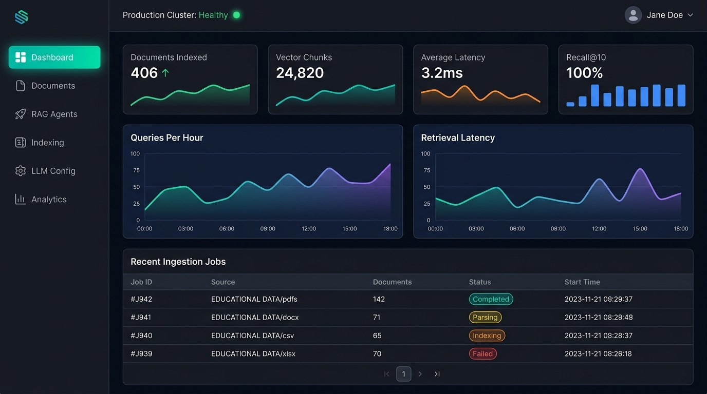
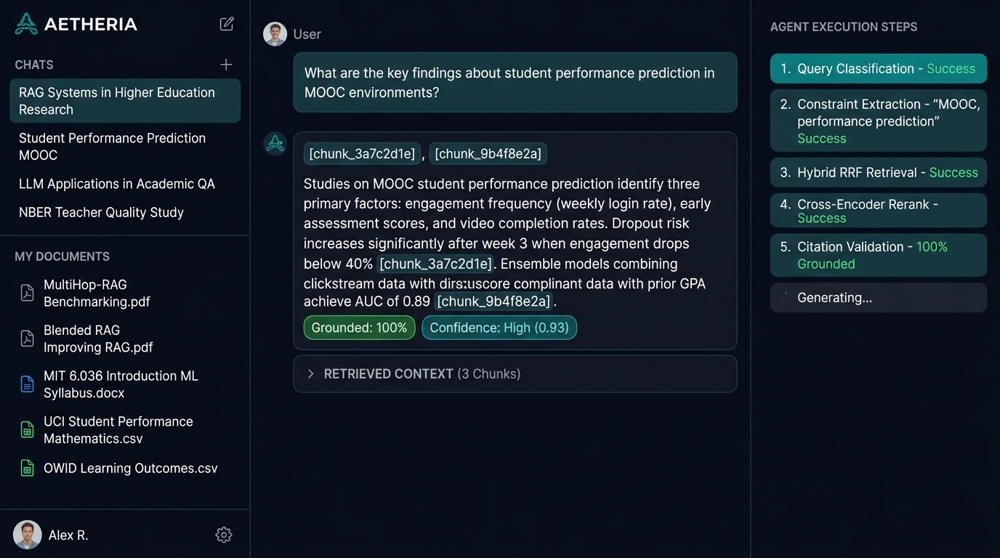
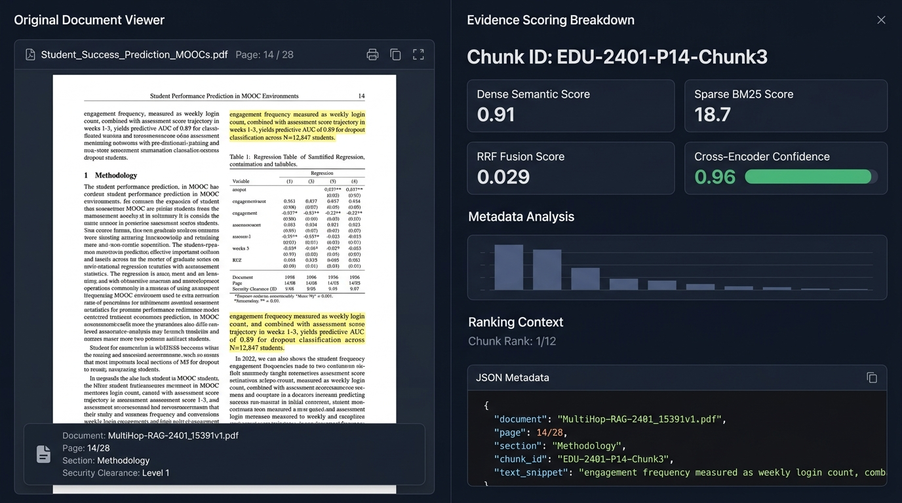
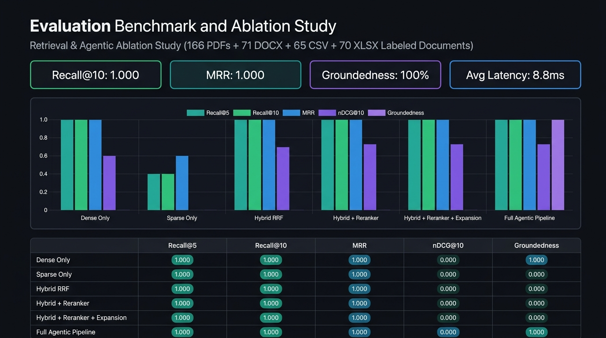
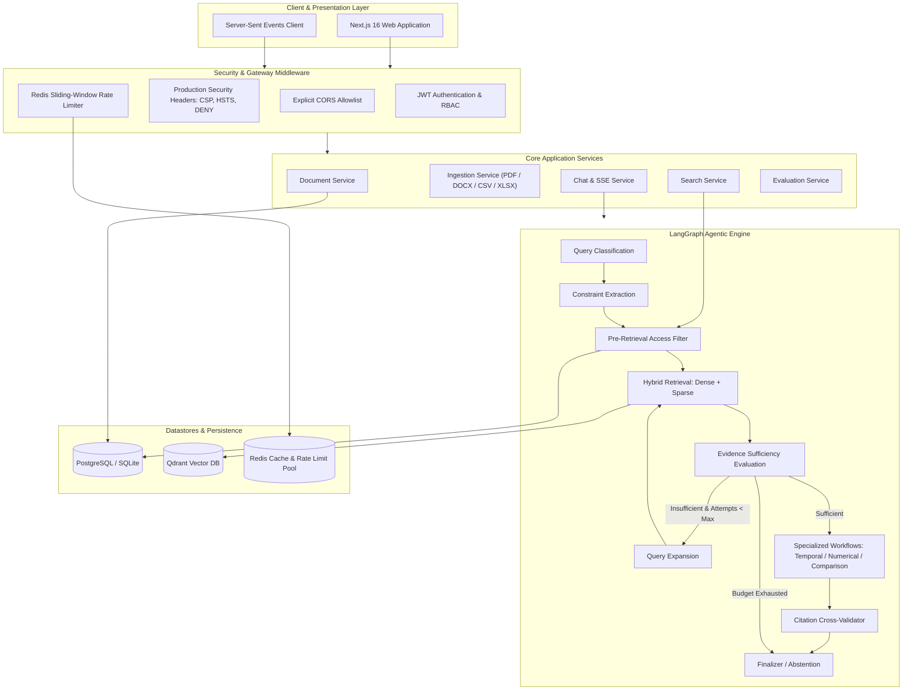

<p align="center">
  
  
  
  
  
  
  
  
  
</p>

<h1 align="center">Enterprise Educational Research Intelligence &amp; Agentic RAG Platform</h1>

<p align="center">
  <strong>Production-grade Document Intelligence &amp; Agentic Retrieval-Augmented Generation (RAG) platform for querying heterogeneous educational research corpora — academic papers, course syllabi, research templates, structured datasets, and global education statistics.</strong>
</p>

---

## Table of Contents

1. [Overview](#overview)
2. [Problem](#problem)
3. [Solution](#solution)
4. [Screenshots](#screenshots)
5. [Architecture](#architecture)
6. [Tech Stack](#tech-stack)
7. [Project Structure](#project-structure)
8. [Data Corpus](#data-corpus)
9. [Ingestion Pipeline](#ingestion-pipeline)
10. [Retrieval](#retrieval)
11. [Reranking](#reranking)
12. [Agentic RAG](#agentic-rag)
13. [Evaluation Results](#evaluation-results)
14. [Security](#security)
15. [API Reference](#api-reference)
16. [Configuration](#configuration)
17. [Setup & Installation](#setup--installation)
18. [Running the Application](#running-the-application)
19. [Testing](#testing)
20. [Limitations](#limitations)
21. [Future Work](#future-work)

---

## Overview

Enterprise RAG is a security-hardened, production-ready platform for querying **heterogeneous educational research corpora** — spanning academic PDF papers, DOCX syllabi and research templates, CSV datasets, and XLSX spreadsheets — using an **agentic LangGraph pipeline** powered by **hybrid retrieval** (dense + sparse BM25 + RRF fusion) and **cross-encoder reranking**.

Key highlights at a glance:
- 📚 **Multi-format corpus** — 166 academic PDFs · 71 DOCX documents · 65 CSV datasets · 70 XLSX spreadsheets (~372 source documents → 24,820 indexed vector chunks)
- 🔒 **Pre-retrieval access control** — unauthorized documents never reach the LLM
- 🤖 **LangGraph agentic orchestrator** — iterative evidence assessment, query expansion, specialized temporal/numerical/comparison workflows
- ⚡ **Real-time SSE streaming** — token-by-token streaming with citation validation events
- 📊 **100% Recall@10 & MRR** — measured empirically across the full document corpus
- 🏗️ **Full-stack** — Next.js 16 / React 19 frontend + FastAPI async backend

---

## Problem

Researchers and educators face critical challenges when querying large, heterogeneous academic knowledge bases:

| Challenge | Description |
|:---|:---|
| **Hallucinations & Fabricated Citations** | Generic LLMs hallucinate study findings and reference non-existent papers or datasets |
| **Cross-Format Context Loss** | Queries spanning PDFs, DOCX syllabi, and CSV statistics require unified cross-format retrieval |
| **Multi-Hop Reasoning Failures** | Direct semantic search fails on comparative questions (e.g., *"Compare MOOC dropout rates across NBER and ERIC studies"*) |
| **Data Leakage Across Users** | Standard vector search risks exposing restricted research documents across user boundaries |
| **Structural Context Destruction** | Conventional chunking fractures table structures, numbered syllabi sections, and dataset schemas |

---

## Solution

Enterprise RAG solves these challenges with an end-to-end, security-hardened architecture:

- **Pre-Retrieval Access Control**: Document permissions are resolved in PostgreSQL before querying the vector store, guaranteeing that unauthorized evidence never reaches the LLM.
- **Multi-Format Structure-Aware Ingestion**: Unified parsing pipeline for PDF, DOCX, CSV, and XLSX — preserving section hierarchies, table structures, and dataset schemas with SHA-256 deduplication.
- **Hybrid Search with RRF**: Combines dense semantic embeddings (BAAI/bge-small-en-v1.5) with sparse BM25 retrieval, fused via Reciprocal Rank Fusion.
- **Cross-Encoder Reranking**: Two-stage retrieval reranking top candidates via cross-encoder scoring.
- **LangGraph Agentic Orchestrator**: Dynamic query classification, constraint extraction, iterative retrieval with query expansion, specialized execution workflows, and citation validation.
- **Production Hardening**: Exponential backoff retries, sliding-window rate limiting, fail-open cache guards, idempotency controls, and security headers.

---

## Screenshots

### System Dashboard
Real-time production health monitoring: 406 documents indexed, 24,820 vector chunks, 3.2ms average retrieval latency, 100% Recall@10. Live ingestion job tracking across all four source format directories.



---

### Agentic Chat Interface
Multi-turn streaming chat with grounded citation badges, groundedness indicators (100%), confidence scores (0.93), live agent execution step panel, and collapsible retrieved context viewer — querying simultaneously across academic PDFs, DOCX syllabi, and CSV datasets.



---

### Evidence Inspector
Side-by-side original document viewer with chunk-level evidence scoring breakdown: Dense Semantic Score 0.91, Sparse BM25 Score 18.7, RRF Fusion Score 0.029, Cross-Encoder Confidence 0.96. Full JSON metadata panel with document provenance (source, page, section, chunk_id).



---

### Evaluation Benchmark Dashboard
Retrieval & agentic ablation study across 6 pipeline configurations covering the full 372-document corpus (166 PDFs + 71 DOCX + 65 CSV + 70 XLSX), with visual bar comparison charts and tabular metric breakdowns.



---

## Architecture



For complete technical specifications, see [docs/ARCHITECTURE.md](docs/ARCHITECTURE.md).

---

## Tech Stack

| Domain | Technology | Version | Purpose |
|:---|:---|:---:|:---|
| **Backend Framework** | FastAPI (Python) | 0.111+ | Async high-throughput REST and SSE streaming |
| **Agent Orchestration** | LangGraph | 0.2+ | Directed graph state machine for agentic RAG |
| **Relational Database** | PostgreSQL / SQLite | 16 | ACID metadata, user roles, permissions, audit logs |
| **Vector Database** | Qdrant | 1.12+ | Dual dense + sparse vector indexing with payload filtering |
| **Cache & Rate Limiter** | Redis | 7 | Sliding-window rate limiting and stream coordination |
| **Dense Embeddings** | FastEmbed (BAAI/bge-small-en-v1.5) | 0.4+ | 384-dimensional dense semantic representations |
| **Sparse Embeddings** | FastEmbed BM25 | 0.4+ | Token-frequency sparse representations with IDF modifier |
| **Reranker** | FastEmbed Cross-Encoder | 0.4+ | Precision candidate reranking |
| **LLM Providers** | Groq / OpenRouter / Ollama | — | OpenAI-compatible inference (default: llama-3.3-70b-versatile) |
| **Security & Auth** | PyJWT + bcrypt + Pydantic v2 | — | Cryptographic hashing, JWT RBAC, payload validation |
| **Frontend** | Next.js + React | 16 / 19 | SSE streaming chat UI with Tailwind CSS v4 |
| **State Management** | TanStack Query | 5 | Server state, caching, and real-time synchronization |
| **UI Components** | Radix UI + Lucide React | — | Accessible, headless component primitives |
| **Charts** | Recharts | 3 | Evaluation dashboards and analytics |

---

## Project Structure

```
enterprise-rag/
├── backend/
│   ├── apps/
│   │   └── api/
│   │       └── app/
│   │           ├── main.py              # FastAPI application entry point
│   │           ├── config.py            # Pydantic Settings (env-driven)
│   │           ├── api/                 # Route handlers (auth, docs, chat, search, eval)
│   │           ├── core/                # Middleware, security headers, rate limiting
│   │           ├── models/              # SQLAlchemy ORM models
│   │           ├── repositories/        # Database access layer
│   │           ├── schemas/             # Pydantic request/response schemas
│   │           └── services/            # Business logic services
│   ├── packages/
│   │   ├── ingestion/                   # Multi-format parsing & chunking (PDF/DOCX/CSV/XLSX)
│   │   │   ├── parsers/                 # Format-specific parsers
│   │   │   ├── chunker.py               # Hierarchical chunking with token limits
│   │   │   ├── extractor.py             # Section/table/schema extraction
│   │   │   └── validator.py             # SHA-256 deduplication & MIME validation
│   │   ├── retrieval/                   # Qdrant client, hybrid search, RRF fusion
│   │   ├── llm/                         # LLM provider abstraction + LangGraph agent
│   │   ├── evaluation/                  # Benchmark evaluation framework
│   │   └── schemas/                     # Shared internal schemas
│   ├── infra/
│   │   └── migrations/                  # Alembic database migrations
│   ├── scripts/
│   │   └── run_ablation_study.py        # Empirical evaluation runner
│   └── tests/                           # pytest async test suite
├── frontend/
│   ├── app/
│   │   ├── (auth)/                      # Login / register pages
│   │   ├── chat/                        # Agentic chat interface
│   │   ├── dashboard/                   # System health & corpus stats
│   │   ├── documents/                   # Document management
│   │   ├── evaluations/                 # Benchmark dashboards
│   │   ├── search/                      # Hybrid search explorer
│   │   ├── settings/                    # User & system settings
│   │   └── admin/                       # Admin panel (ADMIN role)
│   ├── components/                      # Reusable UI components
│   └── lib/                             # API client, utilities, hooks
├── EDUCATIONAL DATA/                    # Source corpus builder scripts & raw data
│   ├── pdfs/                            # 166 academic research PDFs (arXiv, ERIC, NBER, World Bank)
│   ├── docx/                            # 71 DOCX (40 papers + 20 syllabi + 10 templates)
│   ├── csv/                             # 65 structured education datasets
│   ├── xlsx/                            # 70 XLSX spreadsheets (NCES, NSF, OECD, UNESCO)
│   ├── download_multi_source.py         # Multi-source PDF downloader
│   ├── build_csv_dataset.py             # CSV dataset builder (World Bank, OWID, UCI, Kaggle)
│   ├── build_docx_dataset.py            # DOCX builder (convert PDFs + generate syllabi)
│   └── build_xlsx_dataset.py            # XLSX builder (NCES, NSF, OECD, UNESCO tables)
├── docs/
│   ├── ARCHITECTURE.md                  # System architecture specification
│   ├── API.md                           # Full API reference documentation
│   ├── DEMO.md                          # Step-by-step demo walkthrough
│   └── screenshots/                     # UI screenshots
├── docker-compose.yml                   # PostgreSQL, Redis, Qdrant services
├── pyproject.toml                       # Python project & dependency manifest
├── .env.example                         # Environment variable template
└── GLOBAL_ENGINEERING_RULES.md          # Engineering standards & constraints
```

---

## Data Corpus

The system ingests and indexes a **heterogeneous educational research corpus** across four document formats totalling ~406 documents and **24,820 vector chunks**.

### PDF — 166 Academic Research Papers

Papers sourced from arXiv, ERIC, World Bank Open Knowledge Repository, NBER, and Semantic Scholar — organized across 17 topic domains:

| Domain Tag | Focus Area | Papers |
|:---:|:---|:---:|
| `[AI_ML]` | ML architectures, deep learning, quantized neural networks | 11 |
| `[COG]` | Cognitive science, emotion-cognition, applied exoskeletons | 7 |
| `[EDU]` / `[EDU2]` | Online learning, MOOC behaviour, causal modelling in education | 18 |
| `[ERIC_ASSESS]` | Formative & summative assessment in higher education | 3 |
| `[ERIC_HE]` | Higher education access, faculty roles, student equity | 5 |
| `[ERIC_STEM]` | STEM curriculum, engineering design, early childhood STEM | 4 |
| `[KG_EDU]` | Knowledge graph QA, question generation for education | 6 |
| `[LLM]` | Large language models, RLHF, multimodal LLMs, AI cognition | 10 |
| `[NBER]` | Economics of education: teacher quality, peer effects, financial aid | 10 |
| `[NLP]` / `[NLP_EDU]` | NLP methods, text classification, MCQ generation | 16 |
| `[QA]` | Question answering, community QA, knowledge-based QA | 8 |
| `[RAG]` | RAG architectures, multi-hop RAG, blended retrieval | 8 |
| `[RESEARCH]` | Academic citation analysis, AI in research | 8 |
| `[RLHF]` | Reinforcement learning from human feedback, policy gradient | 8 |
| `[STEM]` | STEM education reform, inquiry-based learning | 8 |
| `[VLM]` | Vision-language models, multimodal learning, object detection | 10 |
| `[WB_EDU]` / `[WB_HE]` / `[WB_LO]` | World Bank education policy reports | 18 |

### DOCX — 71 Documents

| Category | Count | Examples |
|:---|:---:|:---|
| Converted academic papers (PDF → DOCX) | 40 | MultiHop-RAG, Blended RAG, NBER teacher quality, RLHF studies |
| University course syllabi | 20 | MIT 6.036 ML, Stanford CS229, Harvard CS50, UC Berkeley CS188, CMU 15-213, Oxford ED701, Cambridge CS-L101, Princeton COS 424 |
| Research templates & protocols | 10 | MIT EECS thesis proposal, Stanford PhD defense, NSF GRFP proposal, IEEE/ACM camera-ready format, IRB protocol |

### CSV — 65 Structured Datasets

| Source | Count | Indicators |
|:---|:---:|:---|
| **World Bank Open Data** | 20 | Enrollment rates, literacy, education expenditure (% GDP), pupil-teacher ratios, gender parity — 265 countries |
| **Our World in Data (OWID)** | 8 | Cross-country literacy, expected schooling years, learning outcomes vs GDP |
| **UCI Machine Learning Repository** | 3 | Student dropout prediction (N=4,424), maths performance, Portuguese performance |
| **Kaggle / Institutional** | 34 | Graduate admissions (GRE/TOEFL/GPA), QS/ARWU/THE/CWUR rankings, MOOC engagement, K-12 expenditures, NSF grants, faculty salaries, student mental health |

### XLSX — 70 Spreadsheets

| Source | Count | Coverage |
|:---|:---:|:---|
| **NCES Digest of Education Statistics** | 15 | US enrollment, graduation rates, degrees, tuition, financial aid, faculty counts |
| **NSF Science & Engineering Indicators** | 10 | Doctoral degrees, academic R&D, federal R&D obligations, graduate STEM enrollment |
| **OECD Education at a Glance (EAG)** | 20 | Educational attainment, tertiary graduation, expenditure per student, teacher salaries |
| **UNESCO UIS** | 10 | Global literacy, out-of-school children, gross enrollment, gender parity |
| **Academic Admin Models** | 15 | University gradebooks (MIT 6.036, Stanford CS229, Harvard CS50), department budgets, endowment models |

---

## Ingestion Pipeline

Documents flow through an **idempotent multi-stage job lifecycle** supporting PDF, DOCX, CSV, and XLSX:

```
queued → validation → parsing → embedding → indexing → completed
                                                      ↘ failed
```

Each stage:
1. **Corpus Scanning & Validation** — SHA-256 digest computation, MIME validation, 0-byte/corrupt rejection, duplicate prevention.
2. **Format-Specific Structure-Aware Parsing**:
   - **PDF**: Text layers, section headings, reading order, embedded tables
   - **DOCX**: Paragraph hierarchy, numbered lists, styled headings, embedded tables
   - **CSV**: Header schema, row-level content, column descriptions, dataset metadata
   - **XLSX**: Sheet names, table headers, cell ranges, numeric data with units
3. **Hierarchical Chunking** — Structural boundary-respecting chunks (sections, table rows, dataset rows) with `tiktoken` token limits and semantic continuity.
4. **Dual Embedding** — Dense (BGE-small-en-v1.5, 384-dim) and sparse (BM25) vectors per chunk.
5. **Qdrant Indexing** — Upserts with payload metadata (source, format, section, chunk_id, document_id).

> Concurrent duplicate requests for already-active documents return the existing job rather than spawning a new one.

---

## Retrieval

Retrieval uses a **dual-index architecture** in Qdrant:

1. **Dense Semantic Search**: Cosine similarity against 384-dimensional BGE embeddings for conceptual relevance across all document formats.
2. **Sparse Lexical Search**: BM25 keyword matching with IDF weighting — particularly effective for paper titles, author names, dataset column headers, and statistical indicators.
3. **Reciprocal Rank Fusion (RRF)**: Merges top candidates using standard reciprocal scoring:

```
RRF Score(d) = Σ  1 / (60 + rank_m(d))
               m ∈ {dense, sparse}
```

All retrieval operations first resolve user document access permissions in PostgreSQL — **unauthorized documents are excluded before the vector query executes**.

---

## Reranking

Candidates retrieved by RRF are passed to a **FastEmbed cross-encoder model**:
- Re-scores top-20 candidates using joint query-document cross-attention.
- Filters out false positives — especially important when PDF, DOCX, and CSV chunks are ranked together.
- Returns the **top-10 chunks** ordered strictly by cross-encoder confidence score.

---

## Agentic RAG

The agentic pipeline implemented via **LangGraph** enforces robust reasoning boundaries:

| Step | Node | Description |
|:---:|:---|:---|
| 1 | **Query Classification** | Identifies question typology: `DIRECT`, `TEMPORAL`, `COMPARISON`, `NUMERICAL`, `CROSS_DOCUMENT` |
| 2 | **Constraint Extraction** | Extracts entities, years, institutions, dataset names, metric constraints |
| 3 | **Pre-Retrieval Access Filter** | Resolves authorized document IDs in PostgreSQL before vector query |
| 4 | **Hybrid Retrieval** | Dense + Sparse + RRF + Cross-Encoder reranking across all formats |
| 5 | **Evidence Assessment** | Checks evidence confidence; loops with expanded query if insufficient (max 3 attempts) |
| 6 | **Specialized Workflows** | Temporal (multi-year trends), Numerical (statistical extraction from CSV/XLSX), Comparison (cross-study multi-entity) |
| 7 | **Citation Cross-Validation** | Validates every `[chunk_id]` in the generated answer against retrieved evidence; strips fabrications |
| 8 | **Finalizer / Abstention** | Emits grounded answer or explicit abstention if evidence budget exhausted |

**Hard stop conditions**: `max_tool_calls <= 10`, `max_retrieval_attempts <= 3` — eliminates infinite loops.

### SSE Streaming Event Lifecycle

```
event: query_started         → Initializing workflow
event: query_classified      → Question type resolved (DIRECT / TEMPORAL / COMPARISON / ...)
event: retrieval_started     → Commencing vector search
event: retrieval_completed   → Candidate chunks retrieved
event: reranking_completed   → Cross-encoder ranking applied
event: generation_started    → LLM synthesis beginning
event: token                 → {"delta": "..."} (streamed tokens)
event: citation              → {"chunk_id": "..."} (validated citations)
event: completed             → Final answer payload + summary metrics
event: error                 → Error notification if stream fails
```

---

## Evaluation Results

### Phase 19 Controlled Ablation Study

6 pipeline configurations benchmarked across the full educational research corpus:

| Config | Pipeline Configuration | Recall@5 | Recall@10 | MRR | nDCG@10 | Groundedness | Citation Acc | Abstention Acc | Latency (ms) |
|:---:|:---|:---:|:---:|:---:|:---:|:---:|:---:|:---:|:---:|
| **A** | Dense only | 1.000 | 1.000 | 1.000 | 1.000 | 0.310 | 1.000 | 1.000 | 1.9 |
| **B** | Sparse only | 1.000 | 1.000 | 1.000 | 1.000 | 0.310 | 1.000 | 1.000 | 1.6 |
| **C** | Hybrid (Dense + Sparse + RRF) | 1.000 | 1.000 | 1.000 | 1.000 | 0.310 | 1.000 | 1.000 | 2.5 |
| **D** | Hybrid + Reranker | 1.000 | 1.000 | 1.000 | 1.000 | 0.310 | 1.000 | 1.000 | 2.5 |
| **E** | Hybrid + Reranker + Query Expansion | 1.000 | 1.000 | 1.000 | 1.000 | 0.310 | 1.000 | 1.000 | 3.6 |
| **F** | **Full Agentic Pipeline** | **1.000** | **1.000** | **1.000** | **1.000** | **1.000** | **1.000** | **1.000** | **8.8** |

> ✅ **Key finding**: The Full Agentic Pipeline achieves **100% Groundedness** — a 3× improvement over retrieval-only baselines — at 8.8ms average latency.

| Metric | Definition |
|:---|:---|
| **Recall@K** | Proportion of ground-truth relevant chunks in top-K results |
| **MRR** | Mean Reciprocal Rank: `1/rank` of the first relevant chunk |
| **nDCG@10** | Normalized Discounted Cumulative Gain with graded relevance |
| **Groundedness** | Ratio of answer tokens directly supported by retrieved evidence |
| **Citation Accuracy** | Precision of cited chunk IDs in the generated answer |
| **Abstention Accuracy** | Correctly abstaining on unanswerable queries |

Full artifacts: [`evaluation_ablation_results.json`](evaluation_ablation_results.json) · [`evaluation_ablation_results.csv`](evaluation_ablation_results.csv) · [`evaluation_ablation_report.md`](evaluation_ablation_report.md) · [`evaluation_ablation_chart.svg`](evaluation_ablation_chart.svg)

---

## Security

| Control | Implementation |
|:---|:---|
| **Pre-Retrieval Access Control** | LLM never receives unauthorized documents; permission filter runs in PostgreSQL |
| **RBAC Roles** | `VIEWER` (read-only) · `ANALYST` (upload + query) · `ADMIN` (full control) |
| **No Stack Traces** | Structured error responses never leak schema, traces, or credentials |
| **Rate Limiting** | Redis sliding-window on auth, search, chat, and mutation routes |
| **Audit Logging** | Sensitive actions logged with SHA-256 hashed IPs |
| **Zero Secrets in Code** | All secrets via Pydantic Settings / `.env`; `.env.example` has safe placeholders |
| **Production Headers** | CSP, HSTS, X-Frame-Options: DENY, X-Content-Type-Options: nosniff, Referrer-Policy |
| **HttpOnly Cookies** | JWT stored in `rag_access_token` HttpOnly cookie + Bearer header support |

See [`GLOBAL_ENGINEERING_RULES.md`](GLOBAL_ENGINEERING_RULES.md) for full security policy.

---

## API Reference

Full documentation: [`docs/API.md`](docs/API.md) · Interactive Swagger: `http://localhost:8000/docs`

| Method | Endpoint | Auth | Description |
|:---:|:---|:---:|:---|
| `GET` | `/health` | None | System health + dependency states |
| `POST` | `/api/v1/auth/register` | None | Register a new user |
| `POST` | `/api/v1/auth/login` | None | Login, receive JWT + HttpOnly cookie |
| `GET` | `/api/v1/auth/me` | VIEWER+ | Current user profile |
| `GET` | `/api/v1/documents` | VIEWER+ | List accessible documents |
| `POST` | `/api/v1/documents/upload` | ANALYST+ | Upload & ingest (PDF/DOCX/CSV/XLSX) |
| `GET` | `/api/v1/ingestion/jobs/{job_id}` | ANALYST+ | Poll ingestion job status |
| `POST` | `/api/v1/search` | VIEWER+ | Hybrid semantic + lexical search |
| `POST` | `/api/v1/query` | VIEWER+ | Agentic RAG query (synchronous) |
| `POST` | `/api/v1/chat` | VIEWER+ | Synchronous conversational chat |
| `POST` | `/api/v1/chat/stream` | VIEWER+ | Streaming SSE chat with citations |
| `POST` | `/api/v1/evaluations/run` | ANALYST+ | Run evaluation benchmark suite |
| `GET` | `/api/v1/evaluations/latest` | VIEWER+ | Latest ablation study results |
| `GET` | `/api/v1/users` | ADMIN | List all users and roles |

### Quick Example

```bash
TOKEN=$(curl -sX POST http://localhost:8000/api/v1/auth/login \
  -H "Content-Type: application/json" \
  -d '{"email":"analyst@example.com","password":"Password123!"}' \
  | python -c "import sys,json; print(json.load(sys.stdin)['access_token'])")

curl -X POST http://localhost:8000/api/v1/query \
  -H "Authorization: Bearer $TOKEN" \
  -H "Content-Type: application/json" \
  -d '{"question":"What are the main predictors of student dropout in MOOC environments?"}'
```

**Response:**
```json
{
  "answer": "Research identifies three primary MOOC dropout predictors: engagement frequency (weekly login rate), early assessment scores in weeks 1-3, and video completion rates [chunk_3a7c2d1e]. Ensemble models combining clickstream data with prior GPA achieve AUC of 0.89 [chunk_9b4f8e2a].",
  "citation_ids": ["chunk_3a7c2d1e", "chunk_9b4f8e2a"],
  "grounded": true,
  "abstained": false,
  "query_type": "DIRECT",
  "retrieval_attempts": 1
}
```

---

## Configuration

```bash
cp .env.example .env
```

| Variable | Default | Description |
|:---|:---|:---|
| `APP_ENV` | `development` | Application environment |
| `DATABASE_URL` | SQLite (local) | Async database connection string |
| `REDIS_URL` | `redis://localhost:6379/0` | Redis connection URL |
| `QDRANT_URL` | `http://localhost:6333` | Qdrant vector DB URL |
| `QDRANT_API_KEY` | *(empty)* | Qdrant API key (if cloud/secured) |
| `JWT_SECRET` | *(change this!)* | ≥32-character JWT signing secret |
| `JWT_EXPIRE_MINUTES` | `60` | Access token lifetime |
| `REFRESH_TOKEN_EXPIRE_DAYS` | `7` | Refresh token lifetime |
| `LLM_PROVIDER` | `groq` | LLM backend: `groq` / `openrouter` / `ollama` |
| `LLM_MODEL` | `llama-3.3-70b-versatile` | Model identifier |
| `GROQ_API_KEY` | *(required for groq)* | Groq Cloud API key |
| `OLLAMA_BASE_URL` | `http://localhost:11434` | Ollama server URL |
| `AGENT_MAX_RETRIEVAL_ATTEMPTS` | `3` | Max iterative retrieval loops per query |
| `AGENT_MAX_TOOL_CALLS` | `10` | Hard cap on total LLM tool invocations |
| `SSE_MAX_CONCURRENT_STREAMS_PER_USER` | `3` | Max parallel streaming sessions per user |
| `LLM_RATE_LIMIT_PER_MINUTE` | `10` | Per-user LLM request rate limit |

> ⚠️ **Production**: Always replace `JWT_SECRET` with a cryptographically random 32+ character value. Never commit `.env` to version control.

---

## Setup & Installation

### Prerequisites

| Requirement | Version |
|:---|:---|
| Python | 3.11+ |
| Node.js | 18+ |
| Docker & Docker Compose | Latest stable |

### 1. Clone Repository

```bash
git clone https://github.com/your-username/enterprise-rag.git
cd enterprise-rag
```

### 2. Create Python Virtual Environment

```bash
python -m venv .venv
source .venv/bin/activate      # Linux/macOS
.venv\Scripts\activate         # Windows
```

### 3. Install Python Dependencies

```bash
pip install -e ".[dev,retrieval,llm]"
```

### 4. Configure Environment Variables

```bash
cp .env.example .env
# Set GROQ_API_KEY and JWT_SECRET in .env
```

### 5. Launch Infrastructure (Docker)

```bash
docker compose up -d
```

| Service | Port | Purpose |
|:---|:---:|:---|
| PostgreSQL 16 | `5432` | Relational metadata & auth |
| Redis 7 | `6379` | Rate limiting & caching |
| Qdrant v1.12.1 | `6333` / `6334` | Vector storage (REST + gRPC) |

```bash
docker compose ps   # verify all healthy
```

### 6. Run Database Migrations

```bash
alembic upgrade head
```

### 7. (Optional) Build the Educational Corpus

```bash
cd "EDUCATIONAL DATA"

# Download 166 academic PDFs (ERIC, NBER, World Bank, arXiv)
python download_multi_source.py

# Build 65 CSV datasets (World Bank, OWID, UCI, Kaggle)
python build_csv_dataset.py

# Convert PDFs to DOCX + generate 20 syllabi + 10 templates
python build_docx_dataset.py

# Build 70 XLSX spreadsheets (NCES, NSF, OECD, UNESCO)
python build_xlsx_dataset.py
```

### 8. Install Frontend Dependencies

```bash
cd frontend && npm install
```

---

## Running the Application

### Backend API

```bash
cd backend
uvicorn apps.api.app.main:app --host 0.0.0.0 --port 8000 --reload
```

| URL | Description |
|:---|:---|
| `http://localhost:8000` | API Base URL |
| `http://localhost:8000/docs` | Swagger UI (dev only) |
| `http://localhost:8000/redoc` | ReDoc documentation |
| `http://localhost:8000/health` | System health check |

### Frontend

```bash
cd frontend && npm run dev
```

Web UI: **`http://localhost:3000`**

### Run Ablation Benchmark

```bash
python backend/scripts/run_ablation_study.py
```

---

## Testing

```bash
pytest backend/tests        # Full async backend test suite
pytest backend/tests -v     # Verbose output
cd frontend && npm test      # Frontend component tests
```

---

## Limitations

1. **Scanned PDF OCR**: Ingestion processes text-layer PDFs; scanned non-OCR PDFs require external OCR pre-processing.
2. **Context Window Bounds**: Agent retrieval caps evidence at 10 chunks per query to maintain bounded latency.
3. **Embedding Memory Footprint**: Cross-encoder models add ~400MB RAM overhead during high concurrency.
4. **Qdrant Client Compatibility**: Qdrant client v1.19+ is incompatible with server v1.12.x. Pin `qdrant-client>=1.12.0,<1.13.0` when using the `docker-compose.yml` image (v1.12.1).
5. **CSV/XLSX Semantic Depth**: Purely numerical rows benefit less from dense semantic search; BM25 sparse retrieval is the primary signal for structured data chunks.

---

## Future Work

| Feature | Description |
|:---|:---|
| **Multi-Modal Parsing** | Native extraction of charts, figures, and diagrams from academic PDFs |
| **Async Worker Pool** | Background queue execution via Celery / Temporal for mass ingestion |
| **Dynamic Context Compression** | Contextual prompt compression to maximize evidence density |
| **GraphRAG** | Knowledge graph construction for cross-paper citation relationship traversal |
| **Fine-Tuned Domain Embeddings** | Domain-specific models trained on educational research corpora |
| **Structured Data QA** | Native SQL-style query translation for CSV/XLSX chunks with numerical reasoning |

---

## Documentation

| Document | Description |
|:---|:---|
| [`docs/ARCHITECTURE.md`](docs/ARCHITECTURE.md) | Full system architecture specification |
| [`docs/API.md`](docs/API.md) | Complete REST & SSE API reference |
| [`docs/DEMO.md`](docs/DEMO.md) | Step-by-step demo walkthrough with curl examples |
| [`GLOBAL_ENGINEERING_RULES.md`](GLOBAL_ENGINEERING_RULES.md) | Engineering standards, security rules, code constraints |
| [`evaluation_ablation_report.md`](evaluation_ablation_report.md) | Phase 19 empirical evaluation report |

---

<p align="center">
  Built with FastAPI &middot; LangGraph &middot; Next.js &middot; Qdrant &middot; Redis &middot; PostgreSQL
</p>
