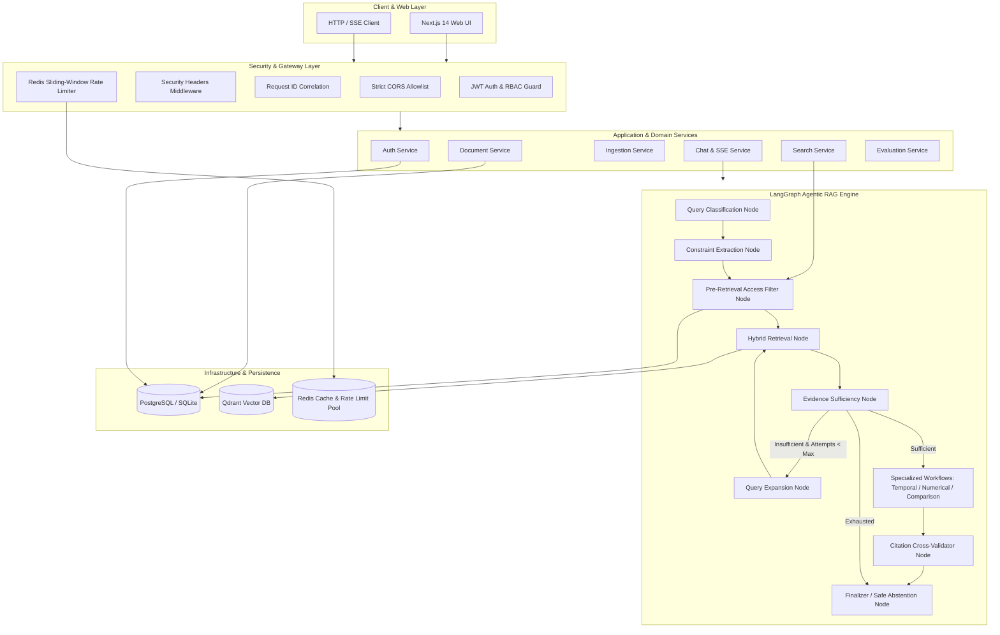
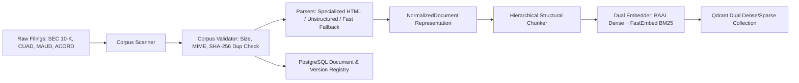

# Enterprise RAG — System Architecture

This document provides a comprehensive technical overview of the Enterprise RAG architecture, covering ingestion, hybrid retrieval, agentic routing, and security boundaries.

---

## 1. High-Level Architecture Diagram



---

## 2. Ingestion Pipeline Architecture



---

## 3. Pre-Retrieval Authorization & Data Isolation (Rule 12, Rule 6)

```text
User Request (JWT) 
  ↓
Extract User ID & Roles from JWT
  ↓
Query PostgreSQL: get_allowed_document_ids(user_id, role_ids, is_admin)
  ↓
If allowed_ids is empty and user is not Admin:
  ↳ Abstain immediately (no vector search, no LLM call)
  ↓
Inject allowed_ids into Qdrant QueryFilter payload constraints
  ↓
Qdrant Vector Search executes ONLY over authorized point IDs
  ↓
LLM receives ONLY authorized evidence chunks
```

---

## 4. LangGraph Agentic Pipeline Topology

1. **`classify_query`**: Classifies query into `DIRECT`, `TEMPORAL`, `COMPARISON`, `NUMERICAL`, `LEGAL`, or `CROSS_DOCUMENT`.
2. **`extract_constraints`**: Extracts entities, fiscal years, metric names, and metadata filters.
3. **`apply_access_filter`**: Injects backend-resolved `authorized_document_ids` into retrieval constraints.
4. **`retrieve`**: Executes dense + sparse search with Reciprocal Rank Fusion (RRF).
5. **`assess_evidence`**: Checks if retrieved evidence contains sufficient semantic score support.
   - If insufficient and attempts < 3: routes to `expand_query` → loops back to `retrieve`.
   - If numerical: routes to `calculate`.
   - If comparison: routes to `retrieve_comparison`.
   - If sufficient or limits reached: routes to `generate`.
6. **`validate_citations`**: Cross-validates all generated `[chunk_id]` tags against actual evidence chunk IDs. Strips hallucinated IDs.
7. **`finalize`**: Formats final answer or returns standard safe abstention. Discards all internal reasoning state before returning to caller.

---

## 5. Reliability & Security Hardening Features (Phase 17)

- **Provider Retries**: Exponential backoff with jitter on HTTP 429, 502, 503, 504, and connect/read timeouts.
- **Fail-Open Rate Limiter**: Redis sliding window automatically fails open if Redis is temporarily unreachable.
- **Database Resilience**: Database errors return clean `503 SERVICE_UNAVAILABLE` without exposing database URLs or internal schema.
- **Idempotency**: Prevents concurrent duplicate ingestion jobs for the same document.
- **Strict Headers**: Enforces CSP, HSTS, X-Frame-Options, X-Content-Type-Options, Referrer-Policy, and Permissions-Policy.
